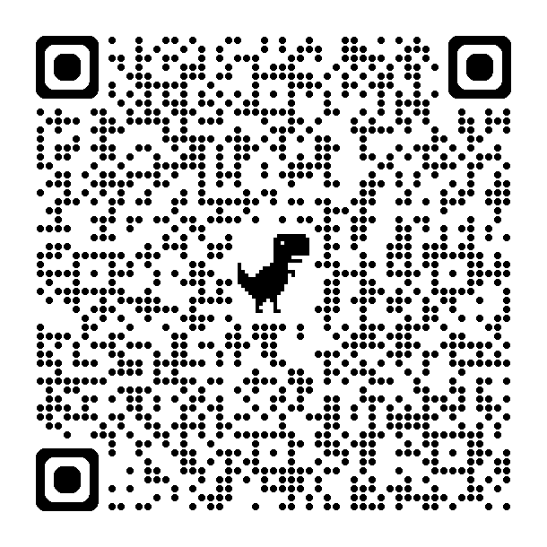

# Mesh IL 📡 — Meshtastic Community Network for Israel
🌐 גרסה בעברית · [Hebrew version](he/)
---
**Community guide for configuring Meshtastic devices on our shared network in Israel** — one place for our shared frequency, channel, and encryption settings.

*Project maintained by [mesh-il](https://github.com/mesh-il) · Hosted on GitHub Pages*
---
## 🌐 Welcome

Welcome to our shared Meshtastic configuration project for Israel!

This guide explains how to set up your device to join the **Mesh IL** community mesh — our shared frequency, channels, and encryption, so your node can talk to ours.

## Disclaimer ⚠️

This guide is provided for community use only, for community educational purposes only.
The authors and maintainers are not responsible for any device damage, interference, or legal issues arising from the use of these settings.
Always follow local regulations and use devices responsibly.
Participation in any shared network (like Telegram groups) is voluntary, and users should exercise caution and avoid sharing personal information.

## 🔍 What Is Meshtastic?

[**Meshtastic**](https://meshtastic.org/) is an open-source project that lets people communicate over long distances **without cellular or internet service** using **LoRa (Long Range) radios**.

Each device acts as a **node** in a mesh network — messages hop automatically from one device to another, extending coverage across cities, trails, or remote areas.

You can use Meshtastic for:

- Off-grid messaging between phones
- Community emergency networks
- Outdoor adventures and events
- IoT and telemetry applications

Meshtastic supports encrypted channels, but this community profile uses public channel settings and should not be treated as private. It remains **low-power** and **free to use** — no SIM card or subscription required.

---

## 📡 Network Overview

This document helps you configure your Meshtastic device with:

- The correct frequency and modem settings
- Shared channel names and encryption
- Recommended hardware and power setups

**The short version: we use the United States LoRa band profile, on frequency slot 70 (919.375 MHz).**

If your device is set to a different region profile (for example, the European 868 MHz profile used by other local groups), it will **not** hear this network. Make sure your device region is set to **United States** before loading our configuration.

---

## 🛠 Getting Started

**Join our community:** [💬 Telegram Group (requires admin approval)](https://t.me/+C4y1eP6NxwlhM2Y0)

### 1. Flash Your Device

Use the [Meshtastic Flasher](https://flasher.meshtastic.org/) to install the latest firmware.

### 2. Load Our Configuration

Use the channel URL or QR code below to configure your device.

## ⚙️ Configuration Summary

| Parameter | Setting | Notes |
|-----------|---------|-------|
| **Region** | United States | Set this in device settings — required for this network |
| **Preset** | Medium Range – Fast (MediumFast) | Good balance of range and latency |
| **Frequency Slot** | 70 | Important: use slot 70 (919.375 MHz) for this network |
| **Center Frequency** | 919.375 MHz | This is US band, slot 70 |
| **MQTT** | Disabled | Enable only if you are a radio "island" that should relay via MQTT |
| **MQTT Root Topic** | `msh/US/IL972` | Only if enabling MQTT |
| **Transmission** | Enabled | |
| **Max Hops** | 7 | Recommended for stable mesh performance |

## 🔗 Channels

Meshtastic channels can use encryption, but a shared public key does **not** provide private communication — anyone with the channel URL or key can read it. Treat everything sent on these channels as public. Our community uses this channel configuration:

| Channel | Description | Encryption Key |
|---------|-------------|----------------|
| **OpenComm** | General community chatting | `AA==` |
| **MediumFast** | MediumFast channel | Public default key (not private) |
| **Testing** | Test channel — keep messages short | `PCJcPH3nb6j6ph63z9+8IDwetI90GkgcYiakDq6TaAg=` |

Import our channels from this URL:

[https://meshtastic.org/e/#ChESAQAaCE9wZW5Db21tOgIIDwoREgEBGgpNZWRpdW1GYXN0OgAKKxIgPCJcPH3nb6j6ph63z9-8IDwetI90GkgcYiakDq6TaAgaB1Rlc3RpbmcSHQgBEAQY-gEgCSgFOAFAB0gBUB5YRmgByAYB0AYC](https://meshtastic.org/e/#ChESAQAaCE9wZW5Db21tOgIIDwoREgEBGgpNZWRpdW1GYXN0OgAKKxIgPCJcPH3nb6j6ph63z9-8IDwetI90GkgcYiakDq6TaAgaB1Rlc3RpbmcSHQgBEAQY-gEgCSgFOAFAB0gBUB5YRmgByAYB0AYC)

You can also use this QR code:

- ⚠️ **This will REPLACE your channel list.** If you use other channels, export/backup them first.
- The shared configuration enables full position precision on OpenComm. Reduce or disable position sharing if you do not want your precise location broadcast.

**Tips for channels:**

- Always import our shared channel configuration to avoid conflicts.
- Adjust the number of hops depending on your network density.
- Do not modify frequency slots unless you are certain about local regulations.

## 📦 Recommended Mesh Devices for Starters

If you're new to Meshtastic, here are some popular and beginner-friendly devices that work well with our shared network settings:

| Device | Notes |
|--------|-------|
| **Seeed Wio Tracker L1** | Includes OLED display, GPS and a 5-way joystick. Based on an NRF chip — much more power efficient. Very easy to flash and popular in the Meshtastic community. Great for outdoor use; small and portable. |
| **Seeed SenseCAP Card Tracker T1000-E** | VERY small, VERY portable. Has a surprisingly good antenna for its size. |
| **Heltec WiFi LoRa 32 V3/V4** | Compact, includes OLED display. V3 has a 0.96" OLED; V4 has an updated board layout. No GPS, high battery consumption. |
| **Generic ESP32 + LoRa modules** | Requires a bit more DIY effort, but very flexible for experimenting with mesh networks. |

**Tips for beginners:**

- Start with a **Heltec** — easiest to flash and widely supported.
- Make sure to flash the **latest Meshtastic firmware** before joining the network.
- Pair your device with the **Meshtastic mobile app** for easier configuration and monitoring.
- **Important:** always select the proper frequency for your region. Using the wrong frequency may be illegal or could interfere with other radio services.

## ❓ FAQ

**Why do you use the US frequency band in Israel?**

This network runs on the United States LoRa band profile — specifically frequency slot 70 (919.375 MHz) — rather than the European band used by some other local groups. In practice this means one thing for you: set your device region to **United States** before loading our configuration, or your device won't communicate with ours.

**Is my conversation private?**

No. Our channels use shared public keys, which means traffic is encrypted in transit but **not private** — anyone with the channel URL or key can read it. Don't send anything you wouldn't want published.

**What happens to my existing channels when I import yours?**

The import **replaces your entire channel list**. If you use personal channels, export and back them up first.

**Do I need MQTT?**

No — MQTT is disabled by default. The only reason to enable it is if your node is a radio "island" (has internet but no direct path into the mesh) and you want it to relay messages. In that case use root topic `msh/US/IL972`.

**I flashed my device but I can't see other nodes. What do I check?**

1. Region set to **United States** (not Europe).
2. Frequency slot 70 / 919.375 MHz.
3. Antenna connected, device has power.
4. Firmware is the latest release.

If it still doesn't work, ask in our [Telegram group](https://t.me/+C4y1eP6NxwlhM2Y0) — that's what it's for.

## About This Project

**Mesh IL** is an independent community project. It is not affiliated with, sponsored by, or endorsed by the official Meshtastic project or Meshtastic, LLC. "Meshtastic" is a trademark of its respective owner.

- GitHub: [mesh-il/meshtastic-alt-il](https://github.com/mesh-il/meshtastic-alt-il)
- Telegram: [💬 Join our group](https://t.me/+C4y1eP6NxwlhM2Y0)
